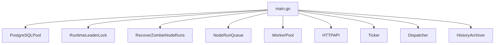
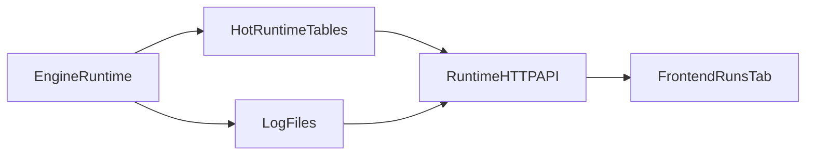
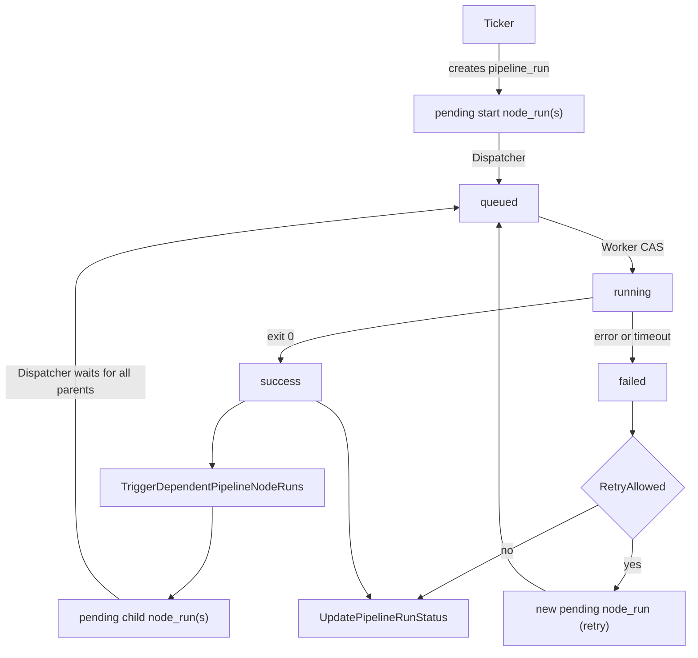

# Архитектура BusyBee

Этот документ описывает текущую внутреннюю модель BusyBee после перехода на
`pipeline -> pipeline_node -> pipeline_run -> pipeline_node_run`.

Если нужен статус HTTP-совместимости, смотри `docs/api.md`.
Если нужен список миграций, смотри `docs/goose.md`.
Если нужен список оставшихся runtime-рисков, смотри `docs/runtime-risks.md`.

---

## 1. Главные сущности

### `busybee_pipeline_group`

Опциональная группа pipeline для UI-каталогизации:

- имя группы
- описание
- список связанных pipeline

Группа не участвует в runtime-исполнении DAG, но является частью definition-слоя.

### `busybee_pipeline`

Определение целого DAG-а:

- имя и описание pipeline
- cron-расписание
- флаг `is_active`
- лимит `max_active_runs`

Это шаблон процесса, а не конкретное выполнение.

### `busybee_pipeline_node`

Исполняемый узел внутри pipeline:

- команда
- timeout
- retry policy
- executor type

Стартовый узел вычисляется по графу:

- у него нет входящих рёбер в `busybee_pipeline_edge`

### `busybee_pipeline_edge`

Ориентированное ребро DAG-а:

- `parent_node_id`
- `child_node_id`

Потомок допускается к исполнению только после `success` всех parent-узлов в рамках
одного `pipeline_run`.

### `busybee_pipeline_runs`

Один запуск целого pipeline.

Статусы:

- `active`
- `completed`
- `failed`
- `stopped`

### `busybee_pipeline_node_runs`

Конкретный запуск конкретного узла внутри одного `pipeline_run`.

Статусы:

- `pending`
- `queued`
- `running`
- `success`
- `failed`
- `stopped`

Один узел может иметь несколько run-ов внутри одного `pipeline_run`:

- первый старт
- retry
- возможный будущий ручной перезапуск

Но одновременно активным может быть только один run этого узла.

### `busybee_history_pipeline_runs` и `busybee_history_pipeline_node_runs`

Архив завершённых запусков, который `HistoryArchiver` выносит из горячих таблиц.

### Слои модели

В текущей архитектуре данные удобно делить на 3 слоя:

- definition: `busybee_pipeline_group`, `busybee_pipeline`, `busybee_pipeline_node`, `busybee_pipeline_edge`
- runtime: `busybee_pipeline_runs`, `busybee_pipeline_node_runs`
- history: `busybee_history_pipeline_runs`, `busybee_history_pipeline_node_runs`

Definition-слой задаёт форму DAG-а и ограничения запуска, runtime-слой отражает
текущее исполнение, а history-слой хранит завершённые run, вынесенные из горячих
таблиц.

---

## 2. Что запускает `main.go`

При старте сервис поднимает:

1. `RecoverZombieNodeRuns`
2. `WorkerPool`
3. HTTP API
4. `Ticker`
5. `Dispatcher`
6. `HistoryArchiver`

`RecoverZombieNodeRuns` вызывается до воркеров и диспетчера. Это важно: сначала
система переводит зависшие `running/queued` node-run обратно в `pending`, потом
снова начинает исполнять pipeline.

Перед запуском runtime-компонентов процесс также берёт PostgreSQL advisory lock.
Это запрещает одновременную работу двух runtime-инстансов BusyBee поверх одной БД.

---

## 3. Роли компонентов

### `RecoverZombieNodeRuns`

При старте переводит `running` и `queued` node-run обратно в `pending`, если
предыдущий процесс BusyBee завершился аварийно.

### `Ticker`

- сканирует `busybee_pipeline`
- ищет активные pipeline с cron
- проверяет `max_active_runs`
- создаёт новый `pipeline_run`
- создаёт `pending` для всех стартовых узлов DAG-а

### `Dispatcher`

- выбирает готовые `pending` node-run
- проверяет `scheduled_at`
- проверяет `success` всех parent-узлов
- переводит node-run в `queued`
- отправляет `node_run_id` в локальную `NodeRunQueue`
- запускает recovery для потерянных child/retry run

### `NodeRunQueue`

Локальная in-memory очередь между `Dispatcher` и `WorkerPool`.

Особенности:

- без ограничения размера
- `Push` не блокируется
- `Pop` блокируется, пока нет работы
- очередь локальна для одного runtime-инстанса

### `WorkerPool`

- берёт `pipeline_node_run.id` из очереди
- запускает команду через `bash -c`
- пишет stdout/stderr в лог-файл
- меняет статусы `queued -> running -> success/failed`
- создаёт retry
- создаёт child node-run после `success`
- обновляет статус `pipeline_run`

### `HistoryArchiver`

Переносит старые завершённые `pipeline_run` и `pipeline_node_run` в архив.

### HTTP API

HTTP API в текущей архитектуре делится на 2 класса возможностей:

- `/health` и `/ready`
- configuration/definition API
- runtime read API

Definition API покрывает:

- `pipeline_group`
- `pipeline`
- `pipeline_node`
- `pipeline_edge`
- graph endpoint `/api/pipelines/{id}/graph`

Runtime read API покрывает:

- список горячих `pipeline_run`
- детальный снимок одного `pipeline_run`
- чтение лога конкретного `pipeline_node_run`

Важно:

- engine является writer-слоем runtime-состояния
- HTTP runtime API только читает горячие таблицы и лог-файлы
- archive-таблицы не участвуют в runtime read API
- отдельный command bus для manual start/stop в текущей архитектуре отсутствует
- изменение и удаление pipeline ограничены при наличии активных `pipeline_run`
- активация pipeline разрешена только после graph validation

---

## 4. Runtime observability

Runtime API не исполняет DAG и не изменяет статусы. Он строит read-model поверх
горячих runtime-таблиц и логов, которые пишет engine.

### Список run

`GET /api/pipeline-runs` читает только горячие `busybee_pipeline_runs` и
`busybee_pipeline_node_runs`.

Для каждого `pipeline_run` API считает:

- `total_nodes` по текущему definition pipeline
- статусные счётчики по latest attempt на каждую node
- `not_started_nodes` для node, у которых в рамках run ещё нет ни одной попытки
- `total_attempts` как число всех `pipeline_node_run` внутри run

Поэтому список run является агрегированным наблюдательным представлением, а не
простым списком строк из `busybee_pipeline_runs`.

### Детальный снимок run

`GET /api/pipeline-runs/{runId}` собирает ответ из нескольких источников:

- один `pipeline_run` из горячей runtime-таблицы
- текущий graph pipeline из definition-слоя
- все попытки `pipeline_node_run` внутри выбранного run

После этого сервис:

- сортирует node в топологическом порядке DAG
- группирует attempts по `pipeline_node_id`
- вычисляет статус node как статус последней попытки
- возвращает `not_started`, если у node ещё нет попыток

Именно поэтому detail endpoint показывает целостную картину pipeline run, а не
только уже созданные строки `node_run`.

### Чтение логов

`GET /api/pipeline-node-runs/{nodeRunId}/log` использует `log_path`, который
воркер записывает при переходе `queued -> running`.

Источник истины здесь разделён:

- PostgreSQL хранит метаданные `node_run` и путь к лог-файлу
- файловая система хранит содержимое `stdout/stderr`

Это делает log endpoint read-only мостом между runtime-метаданными и логами на диске.

---

## 5. Поток выполнения одного pipeline

Что важно:

- `Ticker` создаёт run всего DAG-а
- стартуют все узлы без parent-ов
- child node-run создаётся только когда все parent-узлы уже `success`
- retry создаёт новую строку, а не переиспользует старую

---

## 6. Кто меняет статусы

## `pipeline_node_run`

| Переход | Кто делает |
|---------|------------|
| `new -> pending` | `CreatePipelineRun`, `TriggerDependentPipelineNodeRuns`, retry/recovery-логика |
| `pending -> queued` | `Dispatcher` |
| `queued -> running` | `WorkerPool` |
| `running -> success` | `WorkerPool` |
| `queued/running -> failed` | `WorkerPool` |

## `pipeline_run`

| Переход | Кто делает |
|---------|------------|
| `new -> active` | `CreatePipelineRun` |
| `active -> completed` | `UpdatePipelineRunStatus` |
| `active -> failed` | `UpdatePipelineRunStatus` |
| `active -> stopped` | будущий runtime control, если он будет возвращён |

---

## 7. Инварианты и защиты

### Нет отдельного root-узла

Стартовые узлы вычисляются как узлы без входящих рёбер.

### Один активный node-run на узел в рамках pipeline-run

Это обеспечивает partial unique index `unique_active_node_run_in_pipeline_run`.

### CAS при старте выполнения

Воркер переводит `queued -> running` только через условный `UPDATE`, чтобы не
запустить один и тот же node-run дважды.

### Retry создаёт новую строку

При ошибке текущий run помечается как `failed`, а повтор создаётся отдельной
новой записью с `scheduled_at`.

### Архивируются только завершённые pipeline-run

`HistoryArchiver` переносит только:

- `completed`
- `failed`
- `stopped`

---

## 8. Где смотреть код

- `cmd/main.go` — wiring, порядок запуска компонентов и advisory lock runtime-лидера
- `core/engine/pipelineops.go` — создание `pipeline_run` и стартовых узлов
- `core/engine/ticker.go` — cron-сканер pipeline
- `core/engine/dispatcher.go` — readiness, recovery и fan-in/fan-out логика
- `core/engine/node_run_queue.go` — локальная очередь между диспетчером и воркерами
- `core/engine/worker_pool.go` — исполнение команд, retry, child creation
- `core/engine/history_pipeline.go` — перенос в архив
- `core/api/router.go` — граница HTTP API и список definition/runtime маршрутов
- `core/api/handlers/pipeline_runs.go` — HTTP-вход для runtime read API
- `core/api/services/pipeline_run_service.go` — сборка detail snapshot и топологическая сортировка node
- `core/api/repositories/pipeline_run_repository.go` — read-model для списка run, detail run и `log_path`
- `docs/api.md` — полный HTTP-контракт, поля и правила валидации
